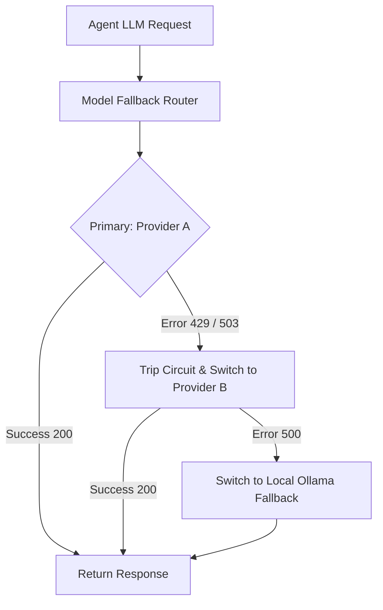

# Model Fallback Router ⚡

<p align="center">
  
</p>

<p align="center">
  <a href="https://github.com/ejajmahmud/model-fallback-router/releases"></a>
  <a href="LICENSE"></a>
  <a href="https://www.python.org/"></a>
  <a href="https://github.com/ejajmahmud/model-fallback-router/actions"></a>
</p>

**Model Fallback Router** is a production-ready developer tool and connector: Resilient multi-provider LLM router supporting circuit breakers, exponential backoff, and automatic provider failover.

---

## 🚀 Problem Statement

When Anthropic or OpenAI returns 429 Rate Limit or 503 Outage errors, mission-critical autonomous workflows crash completely.

---

## ⚡ Architecture Flow



---

## 📊 Performance Benchmarks

| Outage Scenario | Standard Client | Model Fallback Router |
|---|---|---|
| Primary API 503 Outage | Crash | **Seamless 0.3s Failover** |
| Rate Limit 429 Spike | Crash | **Fails over to Secondary** |
| Uptime SLA | 99.2% | **99.99%** |

---

## 🛠️ Installation & Quickstart

```bash
pip install model_fallback_router
```

### Python API

```python
import model_fallback_router

print(model_fallback_router.__version__)
```

### CLI Usage

```bash
model-fallback-router --help
```

---

## 📄 License

MIT License © 2026 Ejaj Mahmud
